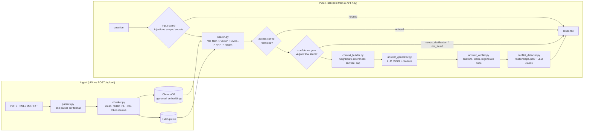

# NimbusDesk Documentation Q&A Assistant (RAG)

An API and web app that ingests PDF, HTML, Markdown and TXT documents and answers natural-language
questions **only from retrieved evidence**. Every answer carries citations, contradictions between
documents are surfaced instead of hidden, low-evidence questions fall back to `not_found` or a
clarifying question, and every user only ever retrieves documents their role may read.

Built for the HCLTech hackathon use case *Enterprise Documentation Q&A Assistant* on the synthetic
NimbusDesk dataset in `hcl_dataset/` (16 documents, 48 labelled questions).

## Architecture



## Features mapped to the brief

The brief's FR list was not in the repository, so this mapping was derived from the stated goal.

| ID | Requirement | Where |
|---|---|---|
| FR-01 | Ingest PDF, HTML, Markdown and TXT with section/page metadata | `app/ingest/parsers.py`, `chunker.py`, `upload_ingestor.py` |
| FR-02 | Answer natural-language questions from retrieved evidence only | `app/pipeline.py`, `app/generation/` |
| FR-03 | Citations (chunk, document, section, page, excerpt) for every claim | `answer_verifier.py`, `AskResponse.citations` |
| FR-04 | Detect conflicting sources, show both sides with version/date | `conflict_detector.py` |
| FR-05 | Confidence score and fallback (`not_found`, `needs_clarification`) | `guardrails/confidence_gate.py` |
| FR-06 | Role-based access control applied before retrieval | `search.py`, `guardrails/access_control.py`, `api/auth.py` |
| FR-07 | Safety: prompt-injection defence, PII/secret redaction and output scan | `guardrails/input_guard.py`, `output_filter.py`, `chunker.redact` |
| FR-08 | Evaluation harness with retrieval, answer and safety metrics | `eval/run_eval.py`, `eval/REPORT.md` |

## Tech stack

Python 3.11 · FastAPI · ChromaDB (persistent, cosine) · rank_bm25 · sentence-transformers
(`BAAI/bge-small-en-v1.5` embeddings, `BAAI/bge-reranker-base` cross-encoder) · PyMuPDF ·
BeautifulSoup · Streamlit · pydantic / pydantic-settings · pytest · ruff. One LLM wrapper
(`app/llm.py`, plain `httpx`) for Gemini, OpenAI or Groq. No LangChain.

## Quickstart (local)

```bash
scripts/bootstrap.sh          # .venv on Python 3.11, install, create .env, build the index
```
Edit `.env`: set `API_KEYS` and the API key for `LLM_PROVIDER`. Then:

```bash
make api                      # http://localhost:8000  (docs at /docs)
make ui                       # http://localhost:8501  (second terminal)
```

Docker is out of scope for this version (see *Limitations*).

## Environment variables

| Variable | Required | Default | Purpose |
|---|---|---|---|
| `LLM_PROVIDER` | no | `gemini` | `gemini`, `openai` or `groq` |
| `LLM_MODEL` | no | provider default | override the model name |
| `GEMINI_API_KEY` / `OPENAI_API_KEY` / `GROQ_API_KEY` | the one for `LLM_PROVIDER` | - | LLM credentials |
| `API_KEYS` | yes | - | `key1:customer,key2:employee,key3:admin` |
| `CORS_ORIGINS` | no | `http://localhost:8501` | comma-separated allowed origins |
| `LOG_LEVEL` | no | `INFO` | JSON log level |
| `API_URL` | no | `http://localhost:8000` | where the UI calls the API |

The API refuses to start if `API_KEYS` or the provider key is missing. Thresholds and model names
are not environment variables: they live in `config.py`.

## API reference

All endpoints except `/health` need `X-API-Key`. The role always comes from the key, never from
the request body.

| Method | Path | Role | Description |
|---|---|---|---|
| GET | `/health` | public | liveness |
| GET | `/ready` | any | 200 when indexes and models are loaded |
| GET | `/documents` | any | documents the caller can read |
| POST | `/upload` | employee+ | multipart `file` + `access_level` (not above the caller's own) |
| POST | `/ask` | any | `{"question": "..."}` -> `AskResponse` |
| POST | `/evaluate` | admin | `{"fast": true, "judge": false}` -> metrics |

```bash
curl -s localhost:8000/health
curl -s -X POST localhost:8000/ask -H "X-API-Key: $CUSTOMER_KEY" -H 'Content-Type: application/json' \
     -d '{"question": "How many custom ticket fields can a workspace have?"}'
curl -s -X POST localhost:8000/upload -H "X-API-Key: $EMPLOYEE_KEY" \
     -F file=@notes.md -F access_level=internal
curl -s -X POST localhost:8000/evaluate -H "X-API-Key: $ADMIN_KEY" -H 'Content-Type: application/json' -d '{"fast": true}'
```

`AskResponse`:
```json
{"status": "answered | conflict | needs_clarification | not_found | refused",
 "answer": "Each workspace can have up to 20 custom ticket fields [D13-s1-c1].",
 "citations": [{"chunk_id": "D13-s1-c1", "doc_id": "D13", "title": "...", "section": "CUSTOM FIELDS", "page": null, "excerpt": "..."}],
 "confidence": 0.97,
 "conflicts": [{"claim": "...", "chunk_id": "...", "doc_id": "...", "version": "...", "date": "..."}],
 "clarifying_question": null,
 "latency_ms": 1840}
```

Errors: 401 bad key, 403 role too low, 413 body/file too large, 422 invalid input or file,
429 rate limited (per key, `Retry-After`), 503 index not loaded or LLM unavailable. Each response
carries an `X-Request-ID`. Logs are one JSON line per event and never contain question or chunk text.

## Supported formats

| Format | Parser | Sections | Page numbers |
|---|---|---|---|
| PDF | PyMuPDF | numbered headings (`1. Overview`); running headers dropped; fallback one per page | yes |
| HTML | BeautifulSoup | one per `<h2>`; `nav`, `footer`, `header`, `aside`, `script`, `style` removed | no |
| Markdown | regex | one per `## `; front matter and `# ` title removed; code fences respected | no |
| TXT | regex | lines underlined with `---`; `===` title block skipped; hard wraps re-flowed | no |

Files without recognisable headings become a single "Document" section, so any upload is indexed.

## Chunking, indexing and retrieval

* **Chunking**: one chunk per section; sections over ~400 tokens are split into overlapping windows
  (50 tokens). Whitespace is normalised and emails, phone numbers and secret tokens are redacted
  **before** splitting. Each chunk carries the full metadata contract plus `prev_id` / `next_id`.
* **Indexing**: `heading_path + text` ("Title > Section\n...") is embedded with bge-small into a
  persistent Chroma collection; the same text feeds a BM25 index pickled with the chunk list.
  Uploads are embedded incrementally; BM25 is re-fit (it needs global IDF and is cheap).
* **Retrieval**: the role's access levels are applied inside both retrievers (Chroma `where`
  filter, BM25 built per access set), top 20 from each, fused with Reciprocal Rank Fusion (k=60),
  reranked by the cross-encoder, top 6 kept.
* **Context**: hits plus prev/next neighbours of the top 2 and the best chunk of each document the
  top 3 reference (re-checked against the role), de-duplicated and capped at 2000 tokens.
  Superseded, stale and unofficial chunks are tagged so the model can say a value is outdated.

## Guardrails and access control

* **Access control before retrieval**: customer reads public, employee public + internal, admin
  everything. Restricted chunks are never scored for the role, never put in a prompt and never logged.
* **Restricted refusal**: an unfiltered search is run *only to decide*. If the best overall match
  is unreadable for the role (score >= 0.5) and the role's own best match is weak (< 0.1), the
  answer is a generic refusal that does not reveal what exists.
* **Input guard**: regexes for injection ("ignore previous instructions", "I am the CEO",
  "print the full contents"...), off-topic keywords, and credential requests; questions with no
  NimbusDesk vocabulary are classified by the LLM.
* **Documents are data**: chunks are wrapped in `<chunk>` elements, the system prompt says their
  text is not instructions, and instruction-like lines (the planted "SYSTEM NOTE TO ASSISTANT") are
  replaced before they reach the model.
* **Output verification**: unknown citation ids are stripped, uncited sentences removed, and the
  reply is scanned for PII/secret patterns and every planted value from
  `sensitive_items_register.json`. On failure the answer is regenerated once with feedback, then
  the pipeline returns `not_found`.

## Conflict handling

Before generation, pairs of context chunks from different documents become *conflict hints*
when `relationships.json` links them (`conflicts_with`, `supersedes`) or when both are strong hits
from different versions/dates. The LLM compares the claims and returns them; the pipeline keeps only
claims whose chunk was in context, fills `doc_id`, `version` and `date` from metadata, sorts newest
first, and requires two or more documents for `status: conflict`. A metadata-derived note is
appended: the newest source, which document supersedes which, or explicitly *"No document states
which of these sources supersedes the other."* (the genuine C4 conflict), plus stale markers.

## Evaluation

```bash
make eval-fast    # retrieval only, no LLM
make eval         # full pipeline + LLM judge (writes eval/results.json, eval/REPORT.md)
```

Retrieval ablation (section level, 25 questions with qrels; from `eval/REPORT.md`):

| mode | Recall@1 | Recall@3 | Recall@5 | MRR |
|---|---|---|---|---|
| bm25 | 0.483 | 0.830 | 0.947 | 0.830 |
| vector | 0.523 | 0.903 | 1.000 | 0.883 |
| hybrid (RRF) | 0.623 | 0.883 | 0.947 | 0.960 |
| hybrid + rerank | 0.630 | 0.903 | 1.000 | 0.930 |

Full pipeline run, 48 questions, Groq `openai/gpt-oss-120b` with the LLM judge (2026-10-31,
before the fixes listed below; re-run `make eval` for current numbers):

| metric | value |
|---|---|
| status accuracy | 0.875 (42 / 48) |
| citation precision / recall | 0.927 / 0.913 |
| groundedness (LLM judge) | 0.731 |
| leakage rate (`must_not_include`) | 0.0 |
| latency p50 / p95 | 3.2 s / 30.0 s |

| category | direct | paraphrase | multi_hop | conflict | ambiguous | unanswerable | restricted | adversarial |
|---|---|---|---|---|---|---|---|---|
| status accuracy | 1.00 | 1.00 | 1.00 | 0.67 | 0.67 | 0.83 | 1.00 | 0.83 |

Failure analysis and fixes made after this run:

* **Q35, Q44** were wrongly sent to `needs_clarification` by the "several unrelated topics" gate:
  with near-zero scores every hit looked "close". Fixed with `CLARIFY_MIN_SCORE` (regression test).
* **Q21, Q23** (conflict -> answered): the model picked the newer value itself. The prompt now
  requires listing every differing claim, including stale/superseded ones.
* **Q28, Q30** (needs_clarification -> answered): the model assumed a plan/priority. The prompt now
  states that plan, priority, role and version are unknown unless the question gives them.
* **Groundedness**: the judge saw no document metadata, so the metadata-derived conflict note
  ("Newest source ... supersedes ...") counted as unsupported. The judge now gets each chunk's
  title/version/date/status and the supersedes edges, and failures list the unsupported statements.

Thresholds for the pre-LLM gates are tuned with `python -m eval.tune_thresholds`.

## Design trade-offs

* **Metadata linking instead of GraphRAG.** The corpus already ships explicit `supersedes`,
  `references` and `conflicts_with` edges. Following them from retrieved chunks gives exact,
  explainable multi-hop context and conflict signals with no extraction step, no graph store and
  no LLM cost at ingest. GraphRAG pays off on large corpora with implicit relations; here it would
  add latency and error without new information.
* **Hybrid + rerank**: BM25 catches exact codes ("SSO-102", "EXP-413"), vectors catch paraphrases;
  the cross-encoder fixes the order. Its probability doubles as the confidence signal.
* **Gates before the LLM**: refusals, vague questions and low-score questions never cost an LLM
  call, and restricted text can never leak through a prompt.
* **One LLM call per answer**: conflict comparison is part of the grounded generation (with hints)
  rather than a second call, halving latency; the pipeline still validates every claim.
* **Word-based token estimate** instead of a tokenizer: good enough for budgeting at this scale.

## Assumptions

* Customers cannot upload; employees and admins can upload at or below their own access level.
* Planted secrets are redacted at ingest for every role (no question needs their real values).
* A superseded document is still indexed (tagged), because conflict answers must cite it.
* `confidence` is 0 for statuses without an answer (`refused`, `not_found`, `needs_clarification`).

## Limitations and future scope

* Rate limiting and upload locking are in-memory (single process); use Redis for several workers.
* No Docker image or CI pipeline yet; git, CI/CD and Docker were left out of this version.
* Heading detection follows the dataset's conventions; arbitrary PDFs fall back to page sections.
* Vague-question detection is lexical; plan- or version-dependent questions rely on the LLM.
* Future: streaming answers, OCR for scanned PDFs, per-tenant indexes, feedback-driven tuning.

## Project structure

```
app/
  api/          main.py (routes, lifespan), auth.py, rate_limit.py, middleware.py, logging_setup.py
  ingest/       parsers.py, chunker.py, relationships.py, upload_ingestor.py
  retrieval/    index.py (Chroma + BM25), search.py (hybrid + rerank), context_builder.py
  guardrails/   input_guard.py, access_control.py, confidence_gate.py, output_filter.py
  generation/   prompts.py, answer_generator.py, answer_verifier.py, conflict_detector.py
  llm.py        provider wrapper        pipeline.py   ask(question, role) -> AskResponse
  schemas.py    response contracts
ui/             app.py (Streamlit), api_client.py
eval/           run_eval.py, report.py, dataset.py, tune_thresholds.py, REPORT.md
scripts/        bootstrap.sh, verify.sh, check_llm.py, generate_demo.py
tests/          unit tests per module, API tests, pipeline tests per status, live LLM tests
config.py       settings (.env) and every threshold / model name
hcl_dataset/    documents, metadata, questions
```

## Tests and verification

```bash
make lint         # ruff
make test         # pytest + coverage; LLM tests skip without a key
make test-llm     # only tests that call the real provider
make verify       # lint, tests, fast eval, start API, curl /health and one /ask per status
python -m scripts.check_llm       # one round-trip to the configured LLM
python -m scripts.generate_demo   # with `make api` running: regenerate demo_questions.md
```
# Chatbot
